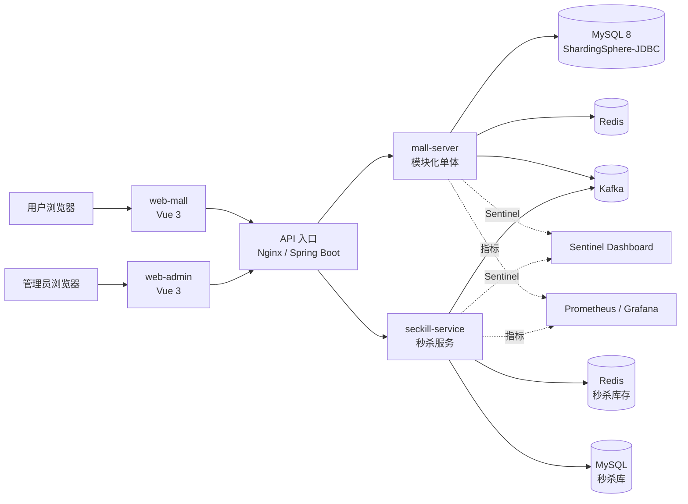
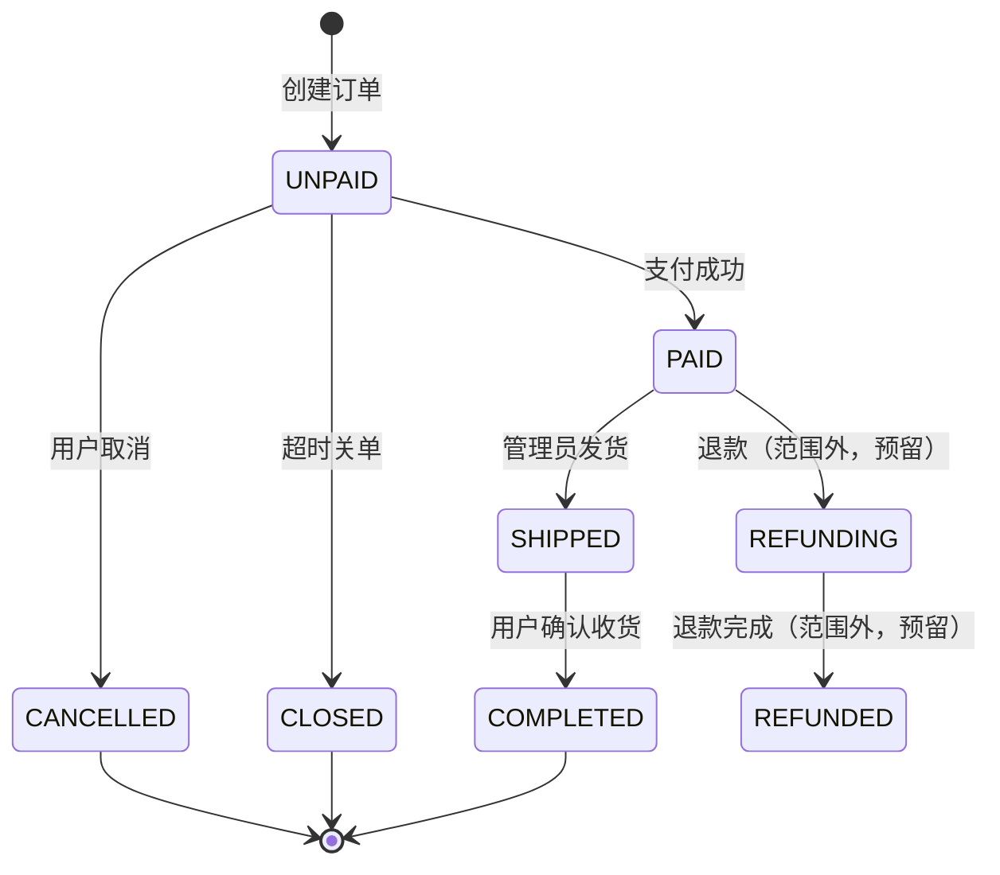
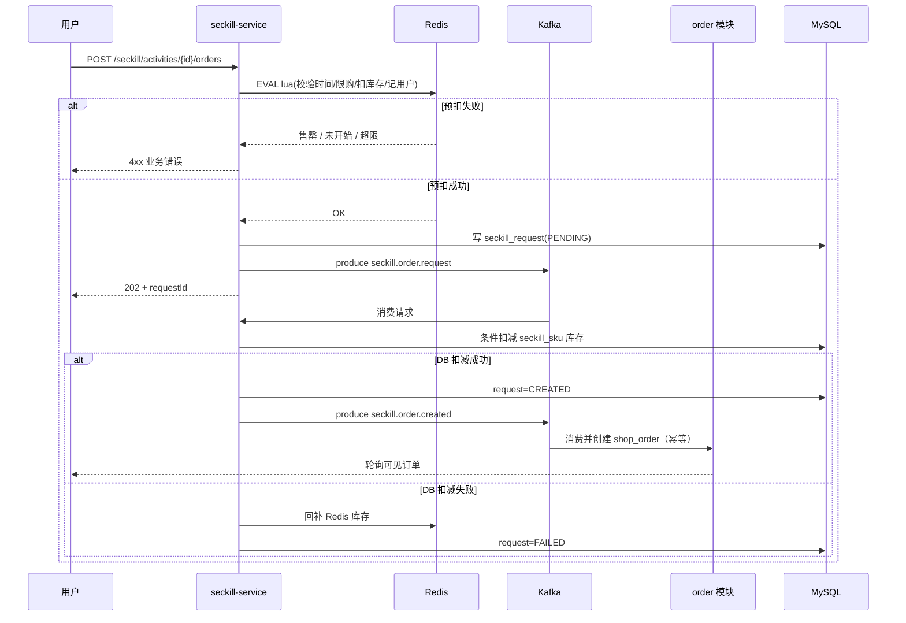

# 图书销售电商系统 需求与规范（v0.2）

> 状态：评审修订中（Q-1 ~ Q-3 已确认，Q-4 ~ Q-10 待确认）
> 版本：v0.2
> 日期：2026-11-16
> 适用项目版本：0.1.0
> 关联决策：架构方案 C（模块化单体 + 秒杀独立服务）、Java 21 / Spring Boot 3.3 / MyBatis-Plus / ShardingSphere-JDBC / Redis / Kafka / Vue 3 / Sentinel / JUnit 5 + Testcontainers / Gatling

---

## 0. 文档信息

### 0.1 变更记录

| 版本 | 日期 | 修改人 | 说明 |
|---|---|---|---|
| v0.1 | 2026-11-16 | adult-KFC | 第一版初稿，覆盖需求、架构、数据、接口、并发一致性、编码与工程规范 |
| v0.2 | 2026-11-16 | adult-KFC | 评审 Q-1 ~ Q-3：支付模拟三模式与支付记录调整、秒杀库存改为独立账本 + 激活预占、超时关单回补规则 |

### 0.2 阅读对象

后端开发、前端开发、测试、运维，以及参与本项目的评审人。

### 0.3 约定

- 文中标注 **【假设】** 的内容为初稿推断，需在评审时确认。
- 标注 **【待定】** 的内容为当前未决策项，见第 14 章。
- 需求编号规则：`FR-<模块>-<序号>`；非功能需求：`NFR-<类别>-<序号>`；约束：`C-<序号>`。
- 本文档是方向性约定；实现细节以下游设计文档和代码为准，变更需回写本文档。

---

## 1. 背景与目标

### 1.1 背景

构建一个图书销售电商系统，覆盖从图书浏览、购物车、下单、库存、支付到后台管理的完整闭环，并包含高并发秒杀场景。项目同时作为工程实践载体，需要体现缓存、消息队列、分库分表、限流熔断、压测与可观测性等能力。

### 1.2 目标

1. 交付可运行、可演示的图书销售 MVP。
2. 支撑秒杀场景峰值下单 **10,000 QPS**（请求到达下单入口），且不发生超卖。
3. 采用清晰的模块边界，使系统可在需要时从模块化单体平滑拆分。
4. 建立可执行的编码规范、测试策略与工程流程。

### 1.3 成功标准

| 编号 | 标准 |
|---|---|
| G-1 | 用户可完成注册、浏览、加购、下单、模拟支付、查看订单的完整流程 |
| G-2 | 管理员可管理图书、库存、订单、用户和秒杀活动 |
| G-3 | 秒杀峰值 10,000 QPS 压测通过，无超卖、无重复下单 |
| G-4 | 关键链路有日志、指标、告警，故障可定位 |
| G-5 | 单元测试、集成测试、压测脚本齐备并接入 CI |

---

## 2. 范围

### 2.1 范围内（MVP）

| 模块 | 能力 |
|---|---|
| 用户与认证 | 注册、登录、JWT 鉴权、个人资料、收货地址 |
| 图书与分类 | 分类浏览、图书列表、搜索、详情 |
| 购物车 | 加购、改数量、删除、勾选、合计 |
| 订单 | 购物车下单、订单列表/详情、取消、超时关单 |
| 库存 | 库存查询、下单扣减、取消/关单回补、后台调整 |
| 支付（模拟） | 发起支付、模拟回调、支付状态查询 |
| 秒杀 | 活动配置、库存预热、限购、异步下单、结果查询、补偿与对账 |
| 后台管理 | 图书、库存、订单、用户、秒杀活动、基础看板 |

### 2.2 范围外（本期不做）

- 真实第三方支付、退款、售后、发票
- 优惠券、满减、会员价、积分
- 商品评价、晒单、问答
- 物流轨迹、多仓发货
- Elasticsearch 搜索、个性化推荐
- 短信/邮件验证码、第三方登录
- 多语言、多币种
- 生产级 Kubernetes 编排（提供可选方案，不作为本期验收项）

### 2.3 角色

| 角色 | 说明 |
|---|---|
| 游客 | 可浏览图书与秒杀活动，不可下单 |
| 注册用户 | 可购物、下单、支付、参与秒杀 |
| 管理员 | 可进入后台管理；本期仅单一 ADMIN 角色 **【假设】** |

---

## 3. 术语

| 术语 | 说明 |
|---|---|
| SPU / SKU | 图书商品与其可售单元；本期一本书即一个 SKU |
| 秒杀 | 限时、限量、限购的高并发销售活动 |
| 预扣 | 在 Redis 中先行扣减秒杀库存，作为流量闸门 |
| 超卖 | 实际售出数量超过可售库存 |
| 幂等 | 同一请求重复执行，结果与副作用只发生一次 |
| Outbox | 本地事务内写事件表，再由后台投递消息，保证“落库与发消息”最终一致 |
| 对账 | 定期比对 Redis 售出数、秒杀请求表、订单表，发现并修复差异 |

---

## 4. 总体架构

### 4.1 架构选型

采用 **方案 C：模块化单体 + 秒杀独立服务**。

理由：

1. 秒杀是唯一需要独立扩缩容与故障隔离的流量热点，单独拆出收益明确。
2. 其余业务保持模块化单体，降低开发、部署、联调与运维成本。
3. 模块之间通过应用服务接口与领域事件解耦，后续可按模块拆分。
4. 相比完整微服务（方案 B），避免过早引入服务治理、分布式事务与多仓部署的复杂度。

### 4.2 逻辑架构



### 4.3 模块职责

#### mall-server（模块化单体）

| 模块 | 职责 | 对外接口 |
|---|---|---|
| `auth` | 注册、登录、令牌签发与校验 | `/api/v1/auth/**` |
| `user` | 用户资料、收货地址 | `/api/v1/users/**` |
| `catalog` | 分类、图书、搜索、详情缓存 | `/api/v1/books/**`、`/api/v1/categories` |
| `cart` | 购物车条目与勾选 | `/api/v1/cart/**` |
| `order` | 订单创建、状态机、查询、取消、超时关单 | `/api/v1/orders/**` |
| `inventory` | 库存扣减、回补、调整、库存流水、秒杀库存预占/释放 | 内部服务 + 后台接口 |
| `payment` | 模拟支付单、回调、幂等处理 | `/api/v1/orders/*/pay`、`/api/v1/payments/**` |
| `admin` | 后台聚合接口、权限校验、看板 | `/api/v1/admin/**` |
| `common` | 统一返回、异常、错误码、幂等、审计、工具 | — |

#### seckill-service（秒杀独立服务）

| 能力 | 职责 |
|---|---|
| 活动与商品 | 秒杀活动、秒杀 SKU、限购规则 |
| 库存预占/释放 | 激活时通过 mall-server 内部接口预占 `book_stock`，结束/停止时释放未售出库存 |
| 库存预热 | 活动开始前将库存写入 Redis |
| 流量闸门 | Redis Lua 原子校验与预扣 |
| 异步下单 | 消费秒杀请求，落库扣减并发出下单事件 |
| 补偿 | 下单失败回补 Redis/DB 库存 |
| 对账 | 定期核对 Redis、请求表、订单表 |
| 管理接口 | 活动创建/启停、库存查询；由后台经内网调用 |

### 4.4 技术栈

| 层 | 选型 | 说明 |
|---|---|---|
| 语言 | Java 21 | LTS |
| 后端框架 | Spring Boot 3.3 | Web、Validation、Actuator |
| ORM | MyBatis-Plus | 分页、乐观锁、条件构造器 |
| 分库分表 | ShardingSphere-JDBC | 订单相关表分片 |
| 数据库 | MySQL 8.0 | 主存储 |
| 缓存 | Redis 7 | 热点缓存、秒杀库存、限流计数、幂等 |
| 消息队列 | Kafka 3.x | 秒杀削峰、领域事件、补偿 |
| 限流熔断 | Sentinel | 网关/接口限流、熔断降级 |
| 前端 | Vue 3 + Vite + TypeScript + Pinia + Vue Router | 商城与后台 |
| UI | Element Plus（后台）、响应式 PC 组件（商城） | **【假设】** |
| 测试 | JUnit 5 + Mockito + Testcontainers | 单元与集成测试 |
| 压测 | Gatling | 秒杀与下单压测 |
| 可观测 | Spring Boot Actuator + Micrometer + Prometheus + Grafana | 指标、日志、告警 |
| 文档 | SpringDoc OpenAPI | 接口文档 |

### 4.5 部署拓扑

**开发/演示环境**

- Docker Compose 编排：MySQL、Redis、Kafka（KRaft 单节点）、Sentinel Dashboard、Prometheus、Grafana。
- `mall-server`、`seckill-service` 各一个实例；前端由 Vite 开发服务器或 Nginx 托管。

**生产环境（可选，非本期验收）**

- 容器化部署，Kubernetes 或等价编排。
- MySQL 主从、Redis 集群/哨兵、Kafka 多 Broker。
- 秒杀服务独立扩缩容，网关层前置限流。

### 4.6 关键设计原则

1. **边界清晰**：模块只通过应用服务接口或领域事件交互，不跨模块直接访问对方表。
2. **单体优先**：非秒杀能力不拆服务，避免分布式复杂度。
3. **缓存与消息只做加速与解耦**：数据库是库存的最终账本；秒杀库存从 `book_stock` 预占，Redis 只做流量闸门，避免物理库存双卖。
4. **最终一致性**：跨服务流程使用事件与补偿，不使用跨库事务。
5. **幂等优先**：所有写接口、消息消费者、支付回调必须幂等。
6. **可观测**：关键链路统一 traceId、结构化日志、核心指标与告警。

---

## 5. 功能需求

### 5.1 用户与认证（FR-AUTH）

| 编号 | 需求 |
|---|---|
| FR-AUTH-01 | 用户可用用户名、邮箱、密码注册；用户名与邮箱唯一 |
| FR-AUTH-02 | 密码使用 BCrypt 存储，禁止明文与可逆加密 |
| FR-AUTH-03 | 登录成功返回 Access Token（JWT，2 小时）与 Refresh Token（7 天）**【假设】** |
| FR-AUTH-04 | 支持刷新令牌与退出登录（令牌加入黑名单或短 TTL 策略） |
| FR-AUTH-05 | 用户可查看、修改昵称与头像；邮箱修改需重新验证 **【假设】** |
| FR-AUTH-06 | 用户可维护多个收货地址，支持设置默认地址 |
| FR-AUTH-07 | 登录失败需限流；连续失败 5 次锁定 15 分钟 **【假设】** |
| FR-AUTH-08 | 后台账号与前台账号隔离，管理员登录走独立入口 |

业务规则：

- 用户名长度 3–32，密码长度 8–64，需包含字母与数字。
- 收货地址包含收货人、手机号、省/市/区、详细地址、是否默认。
- 不允许删除已被未完成订单引用的地址；下单时对地址做快照。

### 5.2 图书与分类（FR-CAT）

| 编号 | 需求 |
|---|---|
| FR-CAT-01 | 支持多级分类（至少两级），分类可排序 |
| FR-CAT-02 | 图书列表支持分类筛选、关键词搜索、价格排序、分页 |
| FR-CAT-03 | 图书详情展示标题、作者、出版社、ISBN、价格、封面、简介、库存状态 |
| FR-CAT-04 | 仅上架且库存可售的图书可下单 |
| FR-CAT-05 | 图书详情使用 Redis 缓存，更新后删除缓存 |
| FR-CAT-06 | 搜索本期使用 MySQL `LIKE` + 索引 **【假设】** |

图书字段（最小集）：`title`、`author`、`publisher`、`isbn`、`category_id`、`price`、`cover_url`、`description`、`status`（DRAFT/ON_SALE/OFF_SALE）。

### 5.3 购物车（FR-CART）

| 编号 | 需求 |
|---|---|
| FR-CART-01 | 登录用户可加购，同一图书累加数量 |
| FR-CART-02 | 可修改数量、删除条目、勾选/取消勾选 |
| FR-CART-03 | 购物车展示可售状态、单价、小计、勾选合计 |
| FR-CART-04 | 加购数量不得超过单笔限购与当前库存 |
| FR-CART-05 | 加购时校验图书状态；失效商品在列表中标记且不可结算 |
| FR-CART-06 | 购物车以数据库为准；本期不做 Redis 购物车 **【假设】** |

### 5.4 订单（FR-ORD）

| 编号 | 需求 |
|---|---|
| FR-ORD-01 | 用户可从购物车勾选商品创建订单，支持多商品 |
| FR-ORD-02 | 下单时校验库存并扣减，扣减与创建订单在同一本地事务内 |
| FR-ORD-03 | 订单金额 = 商品单价 × 数量之和；本期无优惠 |
| FR-ORD-04 | 订单创建成功返回订单号，初始状态为待支付 |
| FR-ORD-05 | 用户可查看订单列表与详情，支持按状态筛选 |
| FR-ORD-06 | 用户可取消待支付订单，取消后回补库存 |
| FR-ORD-07 | 待支付订单超过 30 分钟自动关闭并回补库存 **【假设】** |
| FR-ORD-08 | 订单状态流转必须符合状态机，非法流转返回业务错误 |
| FR-ORD-09 | 订单中的商品信息与收货地址使用快照，不随主数据变化 |
| FR-ORD-10 | 创建订单接口必须支持 `Idempotency-Key`，重复请求返回同一订单 |

订单状态机：



状态说明：

| 状态 | 含义 | 可执行动作 |
|---|---|---|
| `UNPAID` | 待支付 | 支付、取消、超时关闭 |
| `PAID` | 已支付 | 发货 |
| `SHIPPED` | 已发货 | 确认收货 |
| `COMPLETED` | 已完成 | — |
| `CANCELLED` | 已取消 | — |
| `CLOSED` | 超时关闭 | — |

### 5.5 库存（FR-INV）

| 编号 | 需求 |
|---|---|
| FR-INV-01 | 每个图书维护可售库存 `stock`；`locked_stock` 本期不使用，秒杀预占通过扣减 `stock` 实现 |
| FR-INV-02 | 普通下单使用数据库条件更新扣减：`stock >= quantity` 才成功 |
| FR-INV-03 | 订单取消、超时关闭时回补库存，且只回补一次 |
| FR-INV-04 | 管理员可调整库存，调整需记录流水（操作人、前后值、原因） |
| FR-INV-05 | 库存不得为负；任何扣减失败必须回滚业务 |
| FR-INV-06 | 秒杀库存采用“独立账本 + 激活预占”：活动激活时从 `book_stock` 预占秒杀库存，结束/停止时释放未售出部分，见 9.4 |
| FR-INV-07 | 预占与释放必须幂等，记录 `stock_log`（`SECKILL_RESERVE` / `SECKILL_RELEASE`）与预占记录 |
| FR-INV-08 | 预占期间 `book_stock.stock` 不包含已预占的秒杀库存；物理库存不变量见 C-11 |

### 5.6 支付（模拟）（FR-PAY）

| 编号 | 需求 |
|---|---|
| FR-PAY-01 | 用户对待支付订单发起模拟支付，生成支付单 |
| FR-PAY-02 | 模拟支付支持三种模式：`SUCCESS`（默认）、`FAIL`、`NO_CALLBACK`；仅 local/dev/staging 可启用，prod 硬禁用 |
| FR-PAY-03 | 支付回调必须幂等：同一支付单重复回调只生效一次 |
| FR-PAY-04 | 支付成功后订单状态由 `UNPAID` 变为 `PAID`，记录支付时间与支付单号 |
| FR-PAY-05 | 已支付订单不可取消；重复支付直接返回已支付 |
| FR-PAY-06 | 提供支付状态查询接口，供前端轮询 |
| FR-PAY-07 | 模拟回调与模式切换仅允许内网或测试令牌调用，并记录审计日志；prod 不得暴露 |
| FR-PAY-08 | 支付失败后订单保持 `UNPAID`、库存不变，用户可重新发起支付；每次发起生成新的 `payment_no` |

### 5.7 秒杀（FR-SECK）

| 编号 | 需求 |
|---|---|
| FR-SECK-01 | 管理员可创建秒杀活动，配置名称、开始/结束时间、秒杀 SKU、秒杀价、库存、每人限购 |
| FR-SECK-02 | 活动状态：`DRAFT` → `READY` → `ACTIVE` → `STOPPING` → `ENDED`，由管理员或定时任务推进 |
| FR-SECK-03 | 活动开始前将秒杀库存与活动元数据预热到 Redis |
| FR-SECK-04 | 用户只能对进行中的活动下单，且满足每人限购 |
| FR-SECK-05 | 下单入口使用 Redis Lua 原子完成：时间校验、限购校验、库存扣减、用户计数 |
| FR-SECK-06 | 预扣成功后返回 `202 Accepted` 与 `requestId`；前端轮询结果 |
| FR-SECK-07 | 预扣成功的请求写入 Kafka，由消费者异步创建订单 |
| FR-SECK-08 | 同一用户对同一秒杀 SKU 只能成功下单一次（默认限购 1） |
| FR-SECK-09 | 异步下单失败时按 9.6 的统一释放规则回补库存，并记录失败原因；释放必须幂等 |
| FR-SECK-10 | 消费者必须幂等；重复消息不得产生重复订单 |
| FR-SECK-11 | 活动结束后停止接受请求，并清理/归档 Redis 键 |
| FR-SECK-12 | 提供秒杀结果查询接口（处理中/成功/失败/售罄） |
| FR-SECK-13 | 提供对账任务，比对 Redis 售出数、请求表、订单表 |
| FR-SECK-14 | 秒杀订单支付流程与普通订单一致 |
| FR-SECK-15 | 秒杀入口必须接入 Sentinel 限流，超限返回 429 |
| FR-SECK-16 | 超时关单回补规则见 9.6：活动进行中回补秒杀池，活动结束后回补 `book_stock`，均只释放一次 |
| FR-SECK-17 | 超时关单回补库存时不回退用户限购计数；同一用户同一 SKU 仍只能有一个成功订单 |

> 活动激活顺序：预占 `book_stock` → 预热 Redis → `ACTIVE`；任一步失败则释放预占并保持非 `ACTIVE`。

秒杀下单时序：



秒杀业务规则：

- 时间以服务器时间为准，服务端使用 NTP 同步。
- 每人限购默认 1，可按 SKU 配置。
- 同一 `requestId` 的查询与重试结果一致。
- 秒杀价必须低于或等于图书原价。
- 活动进行中禁止修改库存与价格；如需调整，先停止活动。
- 秒杀库存预占或预热失败时活动不得进入 `ACTIVE`，已预占库存必须释放。
- 活动结束采用两步：先置 `STOPPING` 拒绝新请求并等待在途请求处理完，再置 `ENDED` 并释放未售出库存。
- 超时关单回补库存但不回退限购计数。

### 5.8 后台管理（FR-ADM）

| 编号 | 需求 |
|---|---|
| FR-ADM-01 | 管理员登录后可管理图书（新增、编辑、上下架、封面上传 URL） |
| FR-ADM-02 | 管理员可查看与调整库存，查看库存流水 |
| FR-ADM-03 | 管理员可查看订单、按状态/时间/用户筛选、发货 |
| FR-ADM-04 | 管理员可查看用户列表与状态，禁用/启用用户 |
| FR-ADM-05 | 管理员可创建、编辑、启停秒杀活动，查看秒杀进度 |
| FR-ADM-06 | 后台操作需记录审计日志（操作人、动作、对象、时间、IP） |
| FR-ADM-07 | 看板展示今日订单数、销售额、秒杀售出、库存预警等基础指标 **【假设】** |

### 5.9 通用规则

- 所有列表接口分页，默认 20 条，最大 100 条。
- 所有金额使用 `BIGINT` 存分，禁止浮点。
- 所有时间使用 UTC 存储，接口返回 ISO-8601 带时区。
- 所有写接口校验参数并返回统一错误结构。
- 禁止在日志中输出密码、令牌、完整手机号、支付回调敏感字段。

---

## 6. 非功能需求

### 6.1 性能

| 编号 | 指标 | 目标 |
|---|---|---|
| NFR-PERF-01 | 秒杀下单入口峰值 QPS | 10,000 |
| NFR-PERF-02 | 秒杀入口响应时间 | p99 ≤ 200 ms（不含异步落库） |
| NFR-PERF-03 | 异步订单创建延迟 | p99 ≤ 5 s（从预扣成功到订单可查） |
| NFR-PERF-04 | 普通商品浏览 QPS | 500 **【假设】** |
| NFR-PERF-05 | 普通接口响应时间 | p99 ≤ 300 ms |
| NFR-PERF-06 | 下单/支付接口响应时间 | p99 ≤ 500 ms |
| NFR-PERF-07 | 消息积压 | 压测期间峰值 lag ≤ 10,000，5 分钟内消化 |

容量假设 **【假设】**：

- 秒杀请求成功率约 10%，即峰值实际订单约 1,000 单/秒。
- Kafka 秒杀请求主题 12 分区，消费者并发 12。
- 订单表按 `user_id` 分为 2 库 × 2 表，共 4 片。
- Redis 单分片可支撑 10 万级 QPS，生产使用集群。

### 6.2 可用性与容错

| 编号 | 要求 |
|---|---|
| NFR-AVL-01 | 核心浏览与下单链路可用性目标 99.9% **【假设】** |
| NFR-AVL-02 | Redis 不可用时，普通浏览降级到数据库；秒杀入口快速失败 |
| NFR-AVL-03 | Kafka 不可用时，秒杀请求写入失败并回补 Redis 库存，返回可重试错误 |
| NFR-AVL-04 | 数据库主库故障时，读请求可降级；写请求返回 503 |
| NFR-AVL-05 | 所有异步失败可重试；超过重试次数进入死信并告警 |
| NFR-AVL-06 | 定时任务可重复执行，不产生重复副作用 |

### 6.3 安全

| 编号 | 要求 |
|---|---|
| NFR-SEC-01 | 密码 BCrypt；令牌使用强随机密钥并支持轮换 |
| NFR-SEC-02 | 所有管理接口鉴权；前台用户不能访问后台接口 |
| NFR-SEC-03 | 防 SQL 注入：禁止字符串拼接 SQL；MyBatis 使用参数绑定 |
| NFR-SEC-04 | 防 XSS：前端转义，后端对富文本做白名单过滤 |
| NFR-SEC-05 | 防 CSRF：使用 Bearer Token，不使用 Cookie 会话 |
| NFR-SEC-06 | 登录、注册、秒杀、下单接口限流 |
| NFR-SEC-07 | 敏感配置通过环境变量或密钥管理注入，不进入代码仓 |
| NFR-SEC-08 | 依赖漏洞扫描纳入 CI |
| NFR-SEC-09 | 测试夹具不得包含真实用户数据（项目核心约束） |
| NFR-SEC-10 | 模拟支付、失败注入与无回调模式仅允许在 local/dev/staging 启用，prod 必须硬禁用并纳入启动自检 |

### 6.4 可观测性

| 编号 | 要求 |
|---|---|
| NFR-OBS-01 | 日志为结构化 JSON，包含 `traceId`、`userId`、`requestId` |
| NFR-OBS-02 | 暴露 Actuator/Micrometer 指标：QPS、延迟、错误率、线程池、连接池、Kafka lag、Redis 命中率 |
| NFR-OBS-03 | 关键业务指标：下单数、支付数、秒杀预扣成功/失败、补偿次数、对账差异 |
| NFR-OBS-04 | 告警：5xx 比例 > 1%、p99 超阈值、Kafka lag > 10,000、Redis/MySQL 不可用、对账差异 > 0 |
| NFR-OBS-05 | 提供 Grafana 看板与告警规则文件 |

### 6.5 兼容性与可用性

- 商城前端支持最近两个大版本的 Chrome、Edge、Firefox、Safari。
- 后台管理以桌面端为主，最小宽度 1280px。
- 移动端适配为响应式基础支持，不做独立 App **【假设】**。

---

## 7. 数据设计

### 7.1 数据库与分片

- 主库：MySQL 8.0，字符集 `utf8mb4`，排序规则 `utf8mb4_0900_ai_ci`。
- 分库分表：使用 ShardingSphere-JDBC。
- 本期分片范围 **【待评审】**：
  - `shop_order`、`order_item` 按 `user_id` 分片，2 库 × 2 表。
  - 其余表单库单表。
- 分片键选择理由：用户查订单是高频路径；后台按时间/状态查询走广播或独立查询库，本期接受性能折衷。
- 所有业务表包含 `created_at`、`updated_at`；订单类表不做物理删除。

### 7.2 表清单（mall-server）

| 表 | 用途 | 关键字段 | 关键索引/约束 |
|---|---|---|---|
| `sys_user` | 用户 | id, username, email, password_hash, status | uk(username), uk(email) |
| `user_address` | 收货地址 | id, user_id, receiver, phone, region, detail, is_default | idx(user_id) |
| `book_category` | 分类 | id, parent_id, name, sort, status | idx(parent_id) |
| `book` | 图书 | id, isbn, title, author, publisher, category_id, price, cover_url, description, status | uk(isbn), idx(category_id, status) |
| `book_stock` | 库存 | book_id, stock, locked_stock, version, updated_at | pk(book_id) |
| `stock_log` | 库存流水 | id, book_id, change_type, before, after, ref_type, ref_id, operator, remark | idx(book_id, created_at), uk(ref_type, ref_id, change_type) |
| `cart_item` | 购物车 | id, user_id, book_id, quantity, selected | uk(user_id, book_id) |
| `shop_order` | 订单主表 | id, order_no, user_id, status, total_amount, pay_amount, payment_no, receiver_snapshot, stock_released, created_at, paid_at, closed_at | uk(order_no), idx(user_id, status, created_at)；按 user_id 分片 |
| `order_item` | 订单明细 | id, order_id, user_id, book_id, title_snapshot, price, quantity, subtotal | idx(order_id)；按 user_id 分片 |
| `payment_record` | 支付单（每次发起一条） | id, payment_no, order_no, amount, channel, status, paid_at, callback_payload | uk(payment_no), idx(order_no, created_at) |
| `idempotency_record` | 幂等记录 | id, idem_key, user_id, scope, request_hash, response_body, status, expires_at | uk(idem_key) |
| `outbox_event` | 事件发件箱 | id, aggregate_type, aggregate_id, event_type, payload, status, retry_count, next_retry_at | idx(status, next_retry_at) |
| `audit_log` | 审计日志 | id, operator_id, action, target_type, target_id, detail, ip, created_at | idx(operator_id, created_at) |

### 7.3 表清单（seckill-service）

| 表 | 用途 | 关键字段 | 关键索引/约束 |
|---|---|---|---|
| `seckill_activity` | 活动 | id, name, start_time, end_time, status, created_at | idx(status, start_time) |
| `seckill_sku` | 秒杀商品 | id, activity_id, book_id, seckill_price, stock, sold, per_user_limit, version | uk(activity_id, book_id) |
| `seckill_reservation` | 秒杀库存预占 | id, activity_id, sku_id, book_id, reserved_quantity, released_quantity, status, created_at, updated_at | uk(activity_id, sku_id) |
| `seckill_request` | 秒杀请求 | id, request_id, activity_id, user_id, sku_id, quantity, status, order_no, fail_reason, created_at | uk(request_id), uk(activity_id, user_id, sku_id) |
| `seckill_reconcile_log` | 对账记录 | id, activity_id, redis_sold, db_sold, order_count, diff, created_at | idx(activity_id, created_at) |

> `seckill_request` 的 `uk(activity_id, user_id, sku_id)` 保持不变：超时关单回补库存但不回退限购计数，同一用户不能重复下单。

### 7.4 Redis 设计

| Key 模式 | 类型 | TTL | 用途 |
|---|---|---|---|
| `seckill:activity:{activityId}:meta` | Hash | 活动结束后 1 天 | 活动状态、起止时间、版本 |
| `seckill:activity:{activityId}:stock:{skuId}` | String | 活动结束后 1 天 | 秒杀剩余库存 |
| `seckill:activity:{activityId}:user:{skuId}:{userId}` | String | 活动结束后 1 天 | 用户已购数量 |
| `book:detail:{bookId}` | String(JSON) | 30 分钟 ± 随机抖动 | 图书详情缓存 |
| `idem:{scope}:{key}` | String | 24 小时 | 接口幂等结果 |
| `rate:{scene}:{identity}` | String/计数器 | 窗口期 | Sentinel 之外的业务限流 |
| `lock:{scene}:{id}` | String | 30 秒 | 仅定时任务/后台调整使用 |
| `seckill:release:{orderNo}` | String | 7 天 | 库存释放幂等标记（`SET NX`） |

Redis 使用规范：

- 所有键必须带业务前缀与 TTL，禁止无 TTL 的业务键。
- 秒杀库存扣减使用 Lua 脚本，保证“校验 + 扣减 + 记用户”原子性。
- 秒杀库存释放使用 `seckill:release:{orderNo}` 作为幂等标记，`SET NX` 成功后才执行回补。
- 缓存更新采用“先更新数据库，再删除缓存”；删除失败进入重试队列。
- 缓存空值防穿透，TTL 缩短；热点键设置随机过期时间防雪崩。

### 7.5 Kafka 设计

| Topic | 分区 | Key | 保留 | 生产者 | 消费者 |
|---|---|---|---|---|---|
| `seckill.order.request` | 12 | `userId` | 3 天 | seckill-service | seckill-service 下单消费者 |
| `seckill.order.created` | 12 | `orderNo` | 3 天 | seckill-service | mall order 模块 |
| `seckill.order.compensate` | 6 | `requestId` | 7 天 | mall order 模块 | seckill-service 补偿消费者 |
| `mall.order.events` | 6 | `orderNo` | 7 天 | mall order 模块（Outbox 投递） | 支付、通知、统计 |
| `seckill.dlq` | 3 | — | 14 天 | 各消费者 | 人工/告警处理 |

消息规范：

- 消息体包含 `eventId`、`eventType`、`occurredAt`、`traceId`、`payload`。
- 生产端开启 `acks=all`，消费者手动提交位点。
- 消费失败重试 3 次后进入死信并告警。
- 消费者必须按 `eventId` 或业务唯一键去重。

### 7.6 数据一致性与初始化

- 普通订单与库存：本地事务强一致。
- 跨服务：最终一致，依靠 Kafka、幂等消费者、补偿与对账。
- 初始化数据：分类、演示图书、管理员账号。
- 测试夹具只允许使用生成的假数据，禁止真实用户数据。

---

## 8. 接口规范

### 8.1 通用约定

- Base Path：`/api/v1`；内部接口：`/internal`，仅内网可达。
- 协议：HTTPS + JSON；字符集 UTF-8。
- 鉴权：`Authorization: Bearer <access_token>`；后台接口额外校验角色。
- 时间：ISO-8601，例如 `2026-11-16T10:00:00+08:00`。
- 金额：整数，单位为分。
- 分页参数：`page`（从 1 开始）、`size`（默认 20，最大 100）。
- 幂等：写接口支持 `Idempotency-Key` 请求头，键在 24 小时内有效。
- 追踪：响应返回 `X-Request-Id`，与服务端 `traceId` 一致。

统一响应：

```json
{
  "code": 0,
  "message": "ok",
  "data": {},
  "requestId": "8f0f2b1c..."
}
```

分页响应：

```json
{
  "code": 0,
  "message": "ok",
  "data": {
    "items": [],
    "page": 1,
    "size": 20,
    "total": 0
  },
  "requestId": "8f0f2b1c..."
}
```

### 8.2 HTTP 状态码与错误码

HTTP 状态码：

| 状态码 | 场景 |
|---|---|
| 200 | 查询/更新成功 |
| 201 | 创建成功 |
| 202 | 已接受，异步处理中（秒杀） |
| 400 | 参数错误 |
| 401 | 未认证或令牌失效 |
| 403 | 无权限 |
| 404 | 资源不存在 |
| 409 | 冲突（重复、状态不允许） |
| 429 | 限流 |
| 500 | 服务内部错误 |
| 503 | 依赖不可用 |

业务错误码：

| code | 含义 |
|---|---|
| 0 | 成功 |
| 40001 | 参数校验失败 |
| 40101 | 未登录或令牌无效 |
| 40301 | 无权限 |
| 40401 | 资源不存在 |
| 40901 | 重复请求或状态冲突 |
| 42901 | 触发限流 |
| 50001 | 内部错误 |
| 50301 | 依赖服务不可用 |
| 60001 | 库存不足 |
| 60002 | 秒杀未开始/已结束 |
| 60003 | 超过限购数量 |
| 60004 | 订单状态不允许该操作 |
| 60005 | 支付失败 |
| 60006 | 幂等键冲突 |
| 60007 | 秒杀已售罄 |

### 8.3 接口清单

#### 认证与用户

| 方法 | 路径 | 鉴权 | 说明 |
|---|---|---|---|
| POST | `/api/v1/auth/register` | 否 | 注册 |
| POST | `/api/v1/auth/login` | 否 | 登录 |
| POST | `/api/v1/auth/refresh` | 否 | 刷新令牌 |
| POST | `/api/v1/auth/logout` | 是 | 退出 |
| GET | `/api/v1/users/me` | 是 | 当前用户 |
| PUT | `/api/v1/users/me` | 是 | 修改资料 |
| GET/POST/PUT/DELETE | `/api/v1/users/me/addresses` | 是 | 地址管理 |

#### 图书与购物车

| 方法 | 路径 | 鉴权 | 说明 |
|---|---|---|---|
| GET | `/api/v1/categories` | 否 | 分类树 |
| GET | `/api/v1/books` | 否 | 图书列表（分类、关键词、排序、分页） |
| GET | `/api/v1/books/{id}` | 否 | 图书详情 |
| GET | `/api/v1/cart` | 是 | 购物车 |
| POST | `/api/v1/cart/items` | 是 | 加购 |
| PUT | `/api/v1/cart/items/{id}` | 是 | 改数量/勾选 |
| DELETE | `/api/v1/cart/items/{id}` | 是 | 删除 |

#### 订单与支付

| 方法 | 路径 | 鉴权 | 说明 |
|---|---|---|---|
| POST | `/api/v1/orders` | 是 | 创建订单（需 Idempotency-Key） |
| GET | `/api/v1/orders` | 是 | 订单列表 |
| GET | `/api/v1/orders/{orderNo}` | 是 | 订单详情 |
| POST | `/api/v1/orders/{orderNo}/cancel` | 是 | 取消待支付订单 |
| POST | `/api/v1/orders/{orderNo}/pay` | 是 | 发起模拟支付 |
| GET | `/api/v1/orders/{orderNo}/pay-status` | 是 | 支付状态 |
| POST | `/api/v1/payments/mock/callback` | 内部/测试 | 模拟支付回调 |

#### 秒杀

| 方法 | 路径 | 鉴权 | 说明 |
|---|---|---|---|
| GET | `/api/v1/seckill/activities` | 否 | 活动列表 |
| GET | `/api/v1/seckill/activities/{id}` | 否 | 活动详情与商品 |
| POST | `/api/v1/seckill/activities/{id}/orders` | 是 | 秒杀下单（需 Idempotency-Key，返回 202） |
| GET | `/api/v1/seckill/requests/{requestId}` | 是 | 秒杀结果查询 |

#### 后台管理

| 方法 | 路径 | 鉴权 | 说明 |
|---|---|---|---|
| CRUD | `/api/v1/admin/books` | ADMIN | 图书管理 |
| PUT | `/api/v1/admin/books/{id}/stock` | ADMIN | 调整库存 |
| GET | `/api/v1/admin/orders` | ADMIN | 订单管理 |
| POST | `/api/v1/admin/orders/{orderNo}/ship` | ADMIN | 发货 |
| GET | `/api/v1/admin/users` | ADMIN | 用户管理 |
| PUT | `/api/v1/admin/users/{id}/status` | ADMIN | 禁用/启用 |
| CRUD | `/api/v1/admin/seckill/activities` | ADMIN | 秒杀活动管理 |
| POST | `/api/v1/admin/seckill/activities/{id}/activate` | ADMIN | 启动活动（触发预热） |
| POST | `/api/v1/admin/seckill/activities/{id}/stop` | ADMIN | 停止活动 |
| GET | `/api/v1/admin/dashboard/overview` | ADMIN | 基础看板 |

#### 内部接口（仅内网）

| 方法 | 路径 | 说明 |
|---|---|---|
| POST | `/internal/seckill/activities/{id}/preload` | 预热库存到 Redis |
| GET | `/internal/seckill/activities/{id}/progress` | 秒杀进度 |
| POST | `/internal/seckill/requests/{requestId}/compensate` | 补偿请求（兜底） |
| POST | `/internal/inventory/seckill-reservations` | 预占秒杀库存（幂等，mall-server） |
| POST | `/internal/inventory/seckill-reservations/{activityId}/{skuId}/release` | 释放预占库存（幂等，mall-server） |

> `/internal/seckill/**` 由 seckill-service 提供；`/internal/inventory/**` 由 mall-server 提供。

### 8.4 幂等与重试约定

- 客户端对创建订单、秒杀下单必须生成稳定的 `Idempotency-Key`。
- 服务端以 `idem_key` 唯一索引兜底；同一键不同请求体返回 409。
- 异步处理中的秒杀请求返回 202；客户端使用指数退避轮询，间隔 200ms 起，最大 5s。
- 内部重试只针对可重试错误（网络、超时、限流）；业务错误不重试。

---

## 9. 并发与一致性约束（核心）

### 9.1 系统不变量

| 编号 | 不变量 |
|---|---|
| C-1 | 任何时刻 `book_stock.stock >= 0`、`seckill_sku.stock >= 0`、`seckill_sku.sold >= 0` |
| C-2 | 同一时刻未关闭的秒杀订单数 ≤ 活动可售库存；已关闭/失败的订单不占用库存 |
| C-3 | 同一用户对同一秒杀 SKU 最多一个成功订单 |
| C-4 | 同一 `Idempotency-Key` 只产生一次业务副作用 |
| C-5 | 同一支付单重复回调只改变一次订单状态 |
| C-6 | 订单金额等于明细金额之和 |
| C-7 | 已支付订单不可取消、不可重复支付 |
| C-8 | 库存回补只发生一次，且必须对应一次有效的取消/关闭 |
| C-9 | 订单状态只能按状态机流转 |
| C-10 | 消息至少投递一次，消费者按业务唯一键去重 |
| C-11 | 对任意图书，`book_stock.stock + Σ seckill_sku.stock + Σ seckill_sku.sold + 普通销售已扣减数量 = 初始总库存`；预占、释放、秒杀成交只做账本间转移，不改变总量 |
| C-12 | 秒杀库存预占、释放（取消/超时/异步失败）各只发生一次；释放后不得重复回补 |

### 9.2 普通下单事务

`POST /api/v1/orders` 在单个本地事务内完成：

1. 校验用户、购物车条目、图书状态。
2. 对每个图书执行条件更新：`UPDATE book_stock SET stock = stock - ? WHERE book_id = ? AND stock >= ?`；影响行数为 0 则抛出库存不足。
3. 写入 `shop_order` 与 `order_item`（快照）。
4. 写入 `outbox_event`（订单创建事件）。
5. 删除已下单的购物车条目。
6. 提交事务；事务提交后由 Outbox 投递消息。

约束：

- 事务内禁止远程调用、发送 Kafka、调用 Redis 秒杀脚本。
- 同一订单内的商品按 `book_id` 升序扣减，避免死锁。
- 失败整体回滚，不允许部分扣减。

### 9.3 库存扣减策略

| 场景 | 策略 |
|---|---|
| 普通下单 | 数据库条件更新，强一致 |
| 取消/超时关单 | 条件更新回补 + 唯一回补标记，防重复 |
| 后台调整 | 行锁或乐观锁，记录流水 |
| 秒杀激活/结束 | 预占/释放 `book_stock`，幂等 + `stock_log` |
| 秒杀下单 | Redis Lua 预扣 + DB 条件扣减（见 9.4） |

防超卖的三道防线：

1. Redis Lua 原子扣减（流量闸门）。
2. 数据库条件更新 `stock >= quantity`（最终账本）。
3. 唯一约束与对账（兜底发现异常）。

### 9.4 秒杀一致性设计

**库存模型（已确认：独立账本 + 激活预占）**

秒杀库存不共享 `book_stock` 的实时账本，但必须从 `book_stock` 预占，避免同一批物理库存被普通销售和秒杀重复卖出：

- 活动激活时，秒杀服务通过 mall-server 内部接口按 SKU 预占库存；mall-server 以条件更新扣减 `book_stock.stock`，写 `stock_log`（`SECKILL_RESERVE`）和 `seckill_reservation`（`RESERVED`）。
- 预占成功后，秒杀服务再预热 Redis；预占或预热任一步失败，活动不得进入 `ACTIVE`，并释放已预占库存。
- 活动结束/停止时，释放未售出的 `seckill_sku.stock` 回 `book_stock`，写 `SECKILL_RELEASE`；已售出部分不回补。
- 秒杀流程中 Redis 仍是闸门，DB 的 `seckill_sku` 是秒杀账本，`book_stock` 是物理库存总账本。
- 预占通过扣减 `book_stock.stock` 实现（不使用 `locked_stock`）；预占与释放以 `(activity_id, sku_id)` 幂等，重复调用不得重复扣减或回补。

**处理流程**

1. **预占**：活动激活前，按 SKU 调 `/internal/inventory/seckill-reservations` 预占 `book_stock`；幂等键 `(activity_id, sku_id)`。
2. **预热**：预占成功后，将 `stock`、`per_user_limit`、起止时间写入 Redis；失败则释放预占。
3. **闸门**：`POST .../orders` 执行 Lua：
   - 校验活动时间与状态；
   - 校验用户已购数量 < 限购；
   - 校验并扣减 Redis 库存；
   - 用户计数 +1；
   - 返回成功或具体失败原因。
4. **落请求**：预扣成功后写 `seckill_request`（PENDING），唯一键 `(activity_id, user_id, sku_id)` 防重复。
5. **异步下单**：发送 `seckill.order.request`；消费者执行：
   - 以 `request_id` 幂等检查；
   - 条件更新 `seckill_sku`：`stock = stock - 1 AND stock >= 1`；
   - 成功则标记 `CREATED`，发送 `seckill.order.created`；
   - 失败则标记 `FAILED`，按 9.6 释放 Redis/DB 库存，并记录原因。
6. **统一订单**：mall order 模块消费 `seckill.order.created`，以 `requestId` 幂等创建 `shop_order`（状态 `UNPAID`）。
7. **失败补偿**：若统一订单创建失败，发送 `seckill.order.compensate`；秒杀服务按 9.6 释放库存，标记 `FAILED`。
8. **支付与超时**：用户对秒杀订单发起支付，流程与普通订单相同；超时未支付则按 9.6 关单并释放库存。

**关键约束**

- `book_stock` 是物理库存唯一账本；Redis 是闸门，`seckill_sku` 是秒杀账本。
- 预占、释放都必须幂等：以 `(activity_id, sku_id)` / `orderNo` + 状态机条件更新，防止重复扣减或回补。
- 活动结束只释放未售出的秒杀库存；已售出但未支付的订单，其库存在超时关单时释放。
- 秒杀请求表、预占记录、订单表、Redis 计数四者的差异由对账任务发现，不依赖人工盯盘。

### 9.5 支付回调幂等

- `payment_record.payment_no` 唯一；`status` 取值：`PENDING` / `PAID` / `FAILED` / `EXCEPTION`。
- `shop_order.payment_no` 仅在支付成功时写入；失败的支付尝试只保留在 `payment_record`，不影响订单。
- 回调处理先校验订单状态：
  - 订单为 `UNPAID`：`UPDATE payment_record SET status='PAID' WHERE payment_no=? AND status='PENDING'`，再 `UPDATE shop_order SET status='PAID', payment_no=? WHERE order_no=? AND status='UNPAID'`，两步在同一本地事务内。
  - 订单为 `CLOSED` / `CANCELLED`：`payment_record` 标记 `EXCEPTION` 并告警，不修改订单（退款在范围外）。
- 影响行数为 0 说明重复回调或状态冲突，按幂等规则返回；重复回调不产生额外副作用。

### 9.6 超时关单与库存释放

- 定时任务每 1 分钟扫描 `status='UNPAID' AND created_at < now() - 30min` 的订单。
- 使用 `SELECT ... FOR UPDATE SKIP LOCKED` 或条件更新抢占，避免多实例重复处理。
- 普通订单的关单与 `book_stock` 回补在同一本地事务；秒杀订单的关单与 `stock_released` 标记在 mall-server 本地事务，秒杀池/Redis 释放通过事件或内部调用完成，允许最终一致，以释放标记和对账保证不重复。
- 秒杀订单超时关闭时回补库存（已确认方案 B），规则如下：
  - **活动进行中且未到结束时间**：回补 Redis 与 `seckill_sku.stock`，`sold` 减 1；使用 `seckill:release:{orderNo}`（`SET NX`）保证只回补一次。
  - **活动已结束**：不回补 Redis，不复活 `seckill_sku`；将库存回补到 `book_stock`，写 `SECKILL_RELEASE` 流水。活动结束时只释放未售出的 `seckill_sku.stock`，已售出但未支付的库存在超时关单时再释放。
  - **限购计数**：不回退 Redis 用户计数；同一用户同一 SKU 仍只能有一个成功订单（`seckill_request` 唯一键不变）。
  - **释放幂等**：统一调用 `releaseStock(orderNo, reason)`；以 `shop_order.stock_released=0 → 1` 的条件更新 + 状态 `UNPAID → CLOSED` 抢占，只有抢占成功者执行回补。异步下单失败发生在订单创建前，由 `seckill_request` 状态机保证只释放一次。
  - **支付竞态**：关单使用 `UPDATE shop_order SET status='CLOSED' WHERE order_no=? AND status='UNPAID'`；影响行数为 0 则跳过回补。关单后到达的支付回调返回业务错误，不修改订单。
  - 活动结束释放前必须先置 `STOPPING` 停止接单，并等待在途 `seckill.order.request` 处理完或失败，再置 `ENDED`；避免释放后又被在途请求扣减。
  - 回补动作必须记录对账日志，纳入 AC-F-07 / AC-P-04 验收。

### 9.7 分布式锁使用规范

- 核心下单链路不依赖分布式锁，优先使用数据库条件更新与 Redis 原子脚本。
- 仅在以下场景使用锁：后台库存调整、活动启停、定时任务抢占。
- 锁必须设置过期时间，并在 `finally` 中释放；禁止无 TTL 锁。
- 本期可使用 Redis `SET NX PX` 实现，不强制引入额外框架。

### 9.8 消息可靠性

- 生产端：本地事务 + Outbox；投递成功标记 `PUBLISHED`，失败重试并告警。
- 消费端：手动提交位点；处理成功后再提交；失败重试 3 次后进入死信。
- 消费端幂等：`eventId` 去重表或业务唯一键条件更新。
- 禁止在消息消费中执行不可重入的外部副作用。

---

## 10. 编码规范

### 10.1 工程结构

```text
pilot-app/
├─ backend/
│  ├─ mall-server/                  # 模块化单体
│  │  └─ src/main/java/com/pilot/mall/
│  │     ├─ MallApplication.java
│  │     ├─ common/                 # 统一返回、异常、幂等、审计、配置
│  │     └─ modules/
│  │        ├─ auth/
│  │        ├─ user/
│  │        ├─ catalog/
│  │        ├─ cart/
│  │        ├─ order/
│  │        ├─ inventory/
│  │        ├─ payment/
│  │        └─ admin/
│  ├─ seckill-service/              # 秒杀独立服务
│  │  └─ src/main/java/com/pilot/seckill/
│  └─ common/                       # 可选：跨服务共享的纯工具与契约
├─ frontend/
│  ├─ web-mall/                     # 商城前端（Vue 3）
│  └─ web-admin/                    # 后台前端（Vue 3）
├─ deploy/
│  ├─ docker-compose.yml
│  └─ grafana/ prometheus/          # 监控配置
├─ docs/
│  └─ superpowers/specs/
└─ README.md
```

模块内部统一分层：

```text
modules/<module>/
├─ api/            # Controller、请求/响应 DTO、参数校验
├─ application/    # 应用服务、事务边界、用例编排
├─ domain/         # 实体、值对象、领域服务、仓储接口
└─ infrastructure/ # MyBatis Mapper、缓存、消息、外部适配器
```

### 10.2 命名规范

| 对象 | 规则 | 示例 |
|---|---|---|
| 包 | 全小写 | `com.pilot.mall.modules.order` |
| 类 | UpperCamelCase | `OrderApplicationService` |
| 方法/变量 | lowerCamelCase | `createOrder` |
| 常量 | UPPER_SNAKE_CASE | `MAX_PAGE_SIZE` |
| 数据库表/字段 | snake_case | `shop_order`、`created_at` |
| REST 路径 | 小写复数名词 | `/api/v1/books` |
| Kafka Topic | 小写点分 | `seckill.order.request` |
| Redis Key | 冒号分层 | `seckill:activity:1:stock:10` |

### 10.3 接口与 DTO

- Controller 不直接暴露 Entity；请求用 `XxxRequest`，响应用 `XxxResponse`。
- 使用 Jakarta Validation 注解校验，Controller 上使用 `@Validated`。
- 统一返回 `ApiResponse<T>`，由全局异常处理器转换异常。
- 列表接口统一使用分页对象，不返回裸数组。
- 金额字段使用 `Long`（分），禁止 `double`/`float`。

### 10.4 异常与错误码

- 业务异常统一抛出 `BizException(errorCode, message)`。
- 全局异常处理器映射为统一响应与 HTTP 状态码。
- 禁止吞异常；捕获后必须记录日志或转换为业务异常。
- 错误码集中定义在 `ErrorCode` 枚举，禁止散落字符串。

### 10.5 事务与远程调用

- 事务边界在 application 层，方法保持短小。
- 事务内禁止 HTTP、Kafka、Redis 秒杀脚本等远程调用。
- 事务提交后事件使用 `@TransactionalEventListener(phase = AFTER_COMMIT)` 或 Outbox。
- 禁止在循环中开启事务；批量操作使用批量 SQL。
- 只读查询不加事务或使用只读事务。

### 10.6 日志与审计

- 使用 SLF4J，禁止 `System.out`。
- 日志包含 `traceId`，通过 MDC 注入。
- 禁止输出密码、令牌、完整手机号、身份证、支付敏感字段。
- 关键业务动作记录审计日志：登录、下单、支付、取消、库存调整、活动启停。
- 异常日志包含错误码与上下文，但不包含大对象全文。

### 10.7 MyBatis-Plus 使用规范

- 禁止字符串拼接 SQL；复杂查询写在 XML 或使用 Wrapper 参数绑定。
- 分页统一使用 MyBatis-Plus 分页插件，禁止手写 `LIMIT` 拼接。
- 乐观锁字段使用 `@Version`；库存扣减优先条件更新而非先查后改。
- 禁止使用 `SELECT *`；明确列名。
- 逻辑删除只用于必要的配置类表；订单、支付、库存流水不逻辑删除。

### 10.8 缓存使用规范

- 缓存键必须可读、带前缀、带 TTL。
- 更新顺序：先 DB 后删缓存；删除失败记录重试。
- 防穿透：空值缓存 + 短 TTL；防雪崩：TTL 随机抖动；防击穿：热点键互斥重建 **【假设】**。
- 禁止把缓存当唯一数据源（秒杀库存闸门除外，且必须有 DB 账本与对账）。

### 10.9 并发编程规范

- 优先使用不可变对象与无状态服务。
- 线程池必须显式定义核心参数、队列、拒绝策略与名称前缀。
- 禁止使用 `Executors.newFixedThreadPool` 等无界队列工厂方法。
- 共享可变状态必须加锁或使用并发容器；锁粒度尽量小。
- 异步任务必须捕获异常并记录日志。

### 10.10 前端规范

- 使用 Vue 3 Composition API + `<script setup>` + TypeScript。
- 状态管理使用 Pinia；路由使用 Vue Router；请求统一封装 Axios。
- 组件命名 PascalCase；页面级组件放 `views/`，通用组件放 `components/`。
- 统一处理 loading、空态、错误提示与登录失效跳转。
- 禁止在前端硬编码密钥；环境变量通过 Vite `import.meta.env` 注入。
- 表单必须前端校验，但后端校验不可省略。
- 使用 ESLint + Prettier，提交前执行 `lint` 与类型检查。
- 关键页面（登录、下单、支付、秒杀）需有基础可访问性与错误态。

### 10.11 代码质量门禁

| 项 | 要求 |
|---|---|
| 编译 | 零警告（或明确豁免） |
| 单元测试 | 核心模块行覆盖率 ≥ 70% |
| 静态检查 | Checkstyle/Spotless + ESLint/Prettier |
| 依赖漏洞 | 高危漏洞为 0 |
| 代码评审 | 至少 1 人批准 |
| 提交信息 | Conventional Commits |

---

## 11. 工程规范

### 11.1 分支与提交

- 主干分支：`main`，受保护，禁止直接推送。
- 功能分支：`feat/<scope>`；修复：`fix/<scope>`；文档：`docs/<scope>`。
- 提交信息格式：`type(scope): subject`，例如 `feat(order): support idempotent order creation`。
- 合并方式：Squash Merge；PR 描述包含变更点、测试方式、影响面。
- 禁止提交密钥、真实用户数据、本地环境文件。

### 11.2 CI/CD

流水线阶段：

1. 构建与编译。
2. 单元测试。
3. 集成测试（Testcontainers 启动 MySQL/Redis/Kafka）。
4. 静态检查与覆盖率。
5. 依赖漏洞扫描。
6. 构建镜像（可选）。
7. 部署到开发/预发环境（可选）。

门禁：任一阶段失败则阻止合并。

### 11.3 环境与配置

| 环境 | 用途 | 数据 |
|---|---|---|
| local | 本地开发 | Docker Compose，假数据 |
| dev | 联调 | 假数据 |
| staging | 预发/压测 | 脱敏或生成数据 |
| prod | 生产 | 真实数据，严格权限 |

- 配置通过环境变量注入；仓库只保留 `.env.example`。
- 不同环境使用 Spring Profile：`local`、`dev`、`staging`、`prod`。
- 模拟支付/失败注入仅在 `local`、`dev`、`staging` 启用；`prod` 启动时校验必须关闭。
- 密钥使用环境变量或密钥管理服务，禁止写入配置文件。

### 11.4 数据库变更

- 使用 Flyway 管理迁移，脚本命名 `V{yyyyMMddHHmm}__{description}.sql`。
- 迁移脚本只前进不修改；已执行脚本不得变更。
- 大表变更需评估锁表时间，必要时分步执行。
- 每个迁移脚本必须可在空库上从零执行成功。

### 11.5 测试策略

| 层级 | 工具 | 范围 | 要求 |
|---|---|---|---|
| 单元测试 | JUnit 5 + Mockito | 领域逻辑、应用服务 | 核心模块覆盖率 ≥ 70% |
| 集成测试 | Testcontainers | Repository、Redis、Kafka、事务 | 关键链路必须覆盖 |
| 接口测试 | Spring Boot Test + MockMvc | Controller 与鉴权 | 主要接口覆盖 |
| 前端测试 | Vitest（可选） | 工具函数、关键组件 | 逐步补齐 |
| 压测 | Gatling | 秒杀、下单 | 每期发布前执行 |
| 一致性测试 | 自定义脚本 | 超卖、重复下单、重复回调 | 必须通过 |

测试数据规则：

- 使用固定种子与生成器，禁止真实用户数据。
- 集成测试每次使用独立数据库/命名空间，测试结束清理。
- 并发测试至少覆盖：库存扣减、幂等下单、支付回调、秒杀限购。

### 11.6 压测方案

Gatling 场景：

1. **秒杀场景**：10,000 QPS 持续 60 秒，逐步加压；校验响应码分布、p99、无超卖。
2. **普通下单场景**：500 QPS 持续 5 分钟；校验库存一致性。
3. **混合场景**：浏览 + 下单 + 秒杀同时进行；校验隔离性与降级。

验收断言：

- 秒杀入口 5xx 比例 < 0.1%。
- 无超卖：`sold <= stock`，订单数 ≤ 库存。
- 无重复订单：同一用户同一 SKU 成功订单数 ≤ 1。
- 异步订单在 5 秒内可查。
- 超时关单回补只发生一次；活动结束与超时释放不重复回补。
- 压测后对账差异为 0。

### 11.7 监控与告警

- 指标：HTTP QPS/延迟/错误率、JVM、连接池、Redis 命中率、Kafka lag、Outbox 积压、秒杀预扣/补偿次数。
- 日志：集中收集，按 `traceId` 串联。
- 告警渠道：邮件/IM **【假设】**。
- 告警规则纳入仓库，随代码评审。

### 11.8 文档维护

- 接口文档由 SpringDoc 自动生成，随代码更新。
- 架构或流程变更必须更新本文档或新增 ADR。
- README 包含本地启动、测试、压测、常见问题。

---

## 12. 验收标准

### 12.1 功能验收

| 编号 | 验收项 |
|---|---|
| AC-F-01 | 注册、登录、刷新令牌、退出可用 |
| AC-F-02 | 图书浏览、搜索、分类筛选、详情可用 |
| AC-F-03 | 加购、改数量、删除、勾选、合计正确 |
| AC-F-04 | 下单成功扣库存，库存不足下单失败且不产生订单 |
| AC-F-05 | 取消订单回补库存，重复取消不重复回补 |
| AC-F-06 | 模拟支付成功/失败/无回调三模式可用；失败后订单保持待支付且库存不变；重复回调无副作用 |
| AC-F-07 | 普通与秒杀订单超时关单自动执行且只执行一次；秒杀订单按 9.6 回补库存且不重复回补 |
| AC-F-08 | 秒杀活动可创建、预热、启动、停止 |
| AC-F-09 | 秒杀下单返回 202，结果可查询，订单可支付 |
| AC-F-10 | 秒杀售罄、未开始、超限购返回明确错误 |
| AC-F-11 | 后台图书、库存、订单、用户、活动管理可用 |
| AC-F-12 | 后台操作有审计日志 |
| AC-F-13 | 秒杀活动激活时成功预占 `book_stock`；预占或预热失败不得进入 `ACTIVE`；结束后未售出库存回补 |
| AC-F-14 | 支付重试生成新的 `payment_no`，历史支付记录可查询 |

### 12.2 性能与一致性验收

| 编号 | 验收项 |
|---|---|
| AC-P-01 | 秒杀 10,000 QPS 压测通过，5xx < 0.1%，p99 ≤ 200ms |
| AC-P-02 | 异步订单 p99 ≤ 5s 可查 |
| AC-P-03 | 压测后无超卖、无重复订单 |
| AC-P-04 | 压测后 Redis/DB/订单对账差异为 0 |
| AC-P-05 | 普通下单 500 QPS 下库存一致 |
| AC-P-06 | 重复 `Idempotency-Key` 请求返回同一结果 |
| AC-P-07 | 重复支付回调不产生重复状态变更 |
| AC-P-08 | 秒杀预占/释放后物理库存不变量 C-11 成立 |
| AC-P-09 | 活动结束与超时关单并发时，库存不重复回补、不为负 |

### 12.3 安全与工程质量验收

| 编号 | 验收项 |
|---|---|
| AC-S-01 | 未认证访问受保护接口返回 401 |
| AC-S-02 | 普通用户访问后台接口返回 403 |
| AC-S-03 | 登录、秒杀接口限流生效 |
| AC-S-04 | 仓库无密钥、无真实用户数据 |
| AC-S-05 | CI 全绿，核心模块覆盖率达标 |
| AC-S-06 | 接口文档可访问且与实现一致 |
| AC-S-07 | 生产 Profile 下模拟支付与失败注入接口不可用 |

### 12.4 交付物

- 可运行的后端两个服务、前端两个应用。
- Docker Compose 一键启动本地依赖。
- Flyway 迁移脚本与初始化数据。
- 单元/集成/接口测试与 Gatling 压测脚本。
- OpenAPI 文档、README、本文档。
- 监控看板与告警规则。

---

## 13. 里程碑

| 阶段 | 内容 | 退出标准 |
|---|---|---|
| M0 评审 | 本文档评审与修订 | Q-1 ~ Q-3 已确认；Q-4 ~ Q-10 确认后文档定稿 v1.0 |
| M1 脚手架 | 后端/前端工程、Docker Compose、Flyway、CI | 本地一键启动，CI 跑通空测试 |
| M2 基础域 | 用户、认证、图书、分类、购物车、后台图书管理 | 浏览与加购闭环可用 |
| M3 交易域 | 订单、库存、模拟支付、超时关单、后台订单 | 下单支付闭环可用，库存一致 |
| M4 秒杀 | 秒杀服务、Redis 预热、Lua 闸门、Kafka 异步下单、补偿、对账 | 秒杀闭环可用，压测前功能自测通过 |
| M5 加固 | Sentinel、监控告警、安全、Gatling 压测、问题修复 | 性能与一致性验收通过 |
| M6 发布 | 文档、演示数据、发布说明 | v1.0.0 发布 |

---

## 14. 风险与待确认

### 14.1 风险

| 风险 | 影响 | 缓解 |
|---|---|---|
| 秒杀库存预占/释放跨服务 | 预占失败或重复释放导致库存不一致 | 以 `(activity_id, sku_id)` 幂等，异常补偿 + 对账；已确认独立账本 + 激活预占 |
| 本机网络不稳定导致依赖/镜像拉取慢 | 开发效率 | 使用镜像源与本地缓存 |
| 10,000 QPS 压测环境资源不足 | 性能结论不可信 | 压测前评估 CPU/内存/网络，必要时分阶段加压 |
| Kafka/Redis 单点故障 | 秒杀不可用 | 生产多副本；开发环境接受单点 |
| 分片键选择不当 | 后台查询性能差 | 评审分片键；必要时增加查询库 |
| 秒杀超时关单与活动结束并发释放 | 库存重复回补或口径不一致 | 统一 `releaseStock` + 订单状态条件更新 + Redis NX；已确认回补方案 B |
| 范围蔓延（优惠券、评价等） | 延期 | 严格按第 2 章范围执行，新需求走变更 |

### 14.2 待确认问题

| 编号 | 问题 | 初稿建议 |
|---|---|---|
| Q-1 | 支付模拟是否支持失败注入？ | **已确认**：支持 `SUCCESS` / `FAIL` / `NO_CALLBACK`，仅测试环境；`payment_record` 改为多次支付记录 |
| Q-2 | 秒杀库存与普通库存是否共享？ | **已确认**：独立账本 + 激活预占 + 结束释放 |
| Q-3 | 秒杀订单超时关闭是否回补库存？ | **已确认**：回补；活动进行中回秒杀池，结束后回 `book_stock`，幂等且不回退限购计数 |
| Q-4 | 登录方式是否包含手机号/验证码？ | 本期仅用户名/邮箱 + 密码 |
| Q-5 | 后台是否需要多角色 RBAC？ | 本期单 ADMIN，预留权限字段 |
| Q-6 | 订单分片键用 `user_id` 还是 `order_no`？ | `user_id`，后台查询走广播/查询库 |
| Q-7 | 商城 UI 组件库选型？ | 后台 Element Plus；商城自定义响应式组件 |
| Q-8 | 生产部署目标是否 Kubernetes？ | 本期 Docker Compose，K8s 作为可选 |
| Q-9 | 秒杀成功率假设 10% 是否合理？ | 压测时按实际调整 Kafka/DB 容量 |
| Q-10 | 是否需要订单发货与确认收货完整流程？ | 保留状态与后台发货，确认收货做简化版 |

---

## 15. 附录

### 15.1 关键决策来源

- 架构方案 C：2026-11-15 决策记录。
- 技术栈（Java 21、Spring Boot 3.3、MyBatis-Plus、ShardingSphere-JDBC、Redis、Kafka、Vue 3）：2026-11-15 决策记录。
- Sentinel、JUnit 5 + Testcontainers、Gatling：2026-11-16 决策记录。
- 2026-11-16 评审确认：Q-1 支付模拟三模式与支付记录调整；Q-2 秒杀独立账本 + 激活预占；Q-3 超时关单回补。
- 峰值下单 QPS 1w、秒杀为必须场景：2026-11-15 需求确认。
- 禁止提交真实用户数据到测试夹具：项目核心约束。

### 15.2 参考

- MemorySync 项目记忆库：`projects/pilot-app/journal/`
- 后续实施计划：待本文档评审通过后编写
